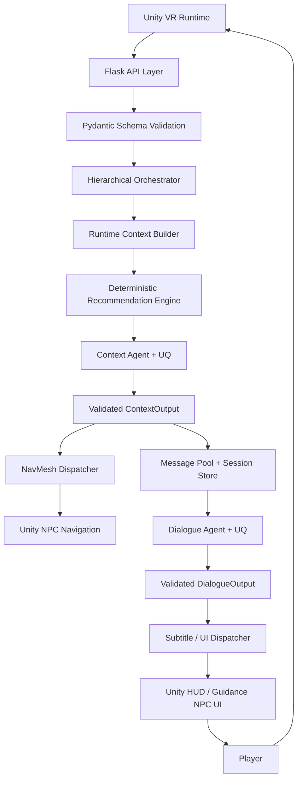

# Current System Architecture: Multi-Agent VR Museum Guide

Dokumen ini menjelaskan arsitektur sistem terbaru pada project **Multi-Agent VR Museum Guide**. Tujuannya adalah memberi konteks lengkap kepada reviewer/LLM lain seperti Claude agar dapat memahami komponen sistem, alur data, proses di tiap blok, tools yang digunakan, schema yang terlibat, serta batasan implementasi saat ini.

## 1. Ringkasan Singkat

Sistem ini adalah backend Flask untuk NPC pemandu museum VR. Unity mengirim snapshot runtime berupa posisi player, scene, timestamp, dan daftar objek budaya. Backend memvalidasi payload, menghitung rekomendasi objek budaya yang belum dikunjungi secara deterministic, lalu menjalankan Context Agent dan Dialogue Agent.

Arsitektur saat ini adalah:

```text
Unity VR
-> Flask API
-> Pydantic Schema Validation
-> Hierarchical Orchestrator
-> Deterministic Recommendation Engine
-> Context Agent + UQ
-> Message Pool / Session Store
-> NavMesh Dispatcher
-> Dialogue Agent + UQ
-> Unity HUD / Guidance NPC UI
-> Player
```

Sistem ini disebut **hybrid multi-agent architecture** karena:

1. LLM agent dipakai untuk bagian interpretatif dan generatif.
2. Keputusan teknis navigasi seperti filtering `visited`, ranking jarak, dan `nav_target` tetap deterministic.
3. UQ hanya diterapkan pada Context Agent dan Dialogue Agent, bukan pada semua komponen.

## 2. Diagram Arsitektur

Diagram PNG terbaru:

```text
docs/figures/latest_system_architecture.png
```

Diagram konseptual:



## 3. Struktur File Utama

| File / Folder | Fungsi |
|---|---|
| `main.py` | Flask API entrypoint. Mendefinisikan endpoint `/context/run`, `/dialogue/run`, `/recommendation/select`, dan endpoint kompatibilitas. |
| `src/orchestration/coordinator.py` | Pusat koordinasi sistem. Berisi `HierarchicalOrchestrator`, `InMemoryMessagePool`, deterministic ranking, context cycle, dialogue cycle, dan selection flow. |
| `src/agents/context_agent.py` | Context Agent, bounded tools, ReAct prompt, dan UQ untuk field interpretatif. |
| `src/agents/dialogue_agent.py` | Dialogue Agent, persona/few-shot prompt, response generation, dan UQ berbasis response similarity + grounding. |
| `src/schema/models.py` | Semua schema Pydantic untuk request, response, context output, dialogue output, session state, dan cultural site. |
| `src/vr_tools/unity_api.py` | Mock Unity API client / HTTP bridge. |
| `src/vr_tools/vr_actions.py` | Action tools untuk mengirim `NAV_TO_TARGET` dan `DISPLAY_SUBTITLE`. |
| `src/vr_tools/vr_perception.py` | Perception helper untuk mengambil status user dan cultural sites dari Unity API client. |
| `src/core/config.py` | Konfigurasi OpenRouter, model, base URL, dan mode mock. |
| `src/core/mock_model.py` | Mock model untuk pengujian lokal deterministic. |
| `data/cultural_sites.json` | Data objek budaya lokal. Saat ini berisi 8 objek budaya. |
| `evals/scenarios.json` | 50 skenario evaluasi. |
| `evals/run_agent_evaluation.py` | Evaluator offline untuk Context Agent, Dialogue Agent, UQ, baseline, dan metric checking. |

## 4. Blok 1: Unity VR Runtime

### 4.1 Peran

Unity VR Runtime adalah sumber utama state dunia. Unity memberi informasi runtime kepada backend dan menerima command dari backend.

Unity berperan sebagai **source of truth** untuk:

- posisi player,
- scene aktif,
- daftar objek budaya,
- status `visited`,
- interaksi player,
- update state setelah objek dikunjungi.

### 4.2 Input

Input ke Unity berasal dari player:

```text
player movement
object interaction
selection option
```

### 4.3 Output ke Backend

Unity mengirim payload ke backend:

```json
{
  "timestamp": "2026-05-01T09:40:00Z",
  "scene": "Heritage_Museum_Wing_A",
  "playerPosition": "12.0, 1.0, 18.0",
  "culturalSites": [
    {
      "id": "Angklung",
      "name": "Angklung",
      "cultural_position": "14.62413, 1.37554, 18.67057",
      "visited": false
    }
  ]
}
```

### 4.4 Output Yang Diterima Dari Backend

Unity menerima command:

```json
{
  "command": "NAV_TO_TARGET",
  "target_id": "Angklung"
}
```

dan:

```json
{
  "command": "DISPLAY_SUBTITLE",
  "text": "Mari menuju Angklung.",
  "duration": 5.0
}
```

### 4.5 Catatan Penting

Backend tidak mengubah `visited` sebagai sumber kebenaran utama. Unity tetap harus mengirim status `visited` terbaru pada request `/context/run` berikutnya.

## 5. Blok 2: Flask API Layer

### 5.1 File

```text
main.py
```

### 5.2 Peran

Flask API Layer adalah pintu masuk request. Block ini tidak melakukan reasoning agent secara langsung, tetapi:

1. menerima request JSON,
2. memvalidasi body,
3. mengubah body menjadi schema Pydantic,
4. memanggil orchestrator,
5. mengembalikan response JSON.

### 5.3 Endpoint Utama

| Endpoint | Method | Fungsi |
|---|---|---|
| `/context/run` | POST | Menjalankan Context Agent dan mengirim `nav_target` ke NavMesh. |
| `/dialogue/run` | POST | Menjalankan Dialogue Agent dari session yang sudah ada. |
| `/recommendation/select` | POST | Menangani pilihan user dari opsi rekomendasi. |
| `/run-simulation` | POST | Endpoint legacy untuk menjalankan context + dialogue sekaligus. |
| `/world/cultural_sites` | GET | Mengambil cultural sites lokal/mock. |
| `/world/cultural_sites` | PUT | Mengupdate cultural sites lokal/mock. |
| `/user/status` | GET | Mengambil status user mock. |

### 5.4 Endpoint `/context/run`

Input:

```text
SimulationRequest
```

Proses:

1. Parse JSON body.
2. Validate dengan `SimulationRequest`.
3. Panggil `orchestrator.run_context_cycle(sim_request)`.
4. Return `ContextCycleResponse`.

Output:

```json
{
  "status": "success",
  "message": "Context agent executed successfully",
  "data": {
    "simulation_id": "...",
    "context": {},
    "navmesh_ack": true
  }
}
```

### 5.5 Endpoint `/dialogue/run`

Input:

```json
{
  "simulationId": "..."
}
```

Proses:

1. Validate `DialogueCycleRequest`.
2. Load session dari `simulationId`.
3. Jalankan Dialogue Agent.
4. Dispatch subtitle ke Unity.
5. Return `DialogueCycleResponse`.

### 5.6 Endpoint `/recommendation/select`

Input:

```json
{
  "simulationId": "...",
  "selectedOption": "Julang Ngapak"
}
```

Proses:

1. Validate `RecommendationSelectionRequest`.
2. Load session.
3. Pastikan `selectedOption` ada di rekomendasi aktif.
4. Update `nav_target` ke objek terpilih.
5. Dispatch `NAV_TO_TARGET`.
6. Jalankan Dialogue Agent untuk confirmation dialogue.
7. Dispatch subtitle.

Jika `selectedOption` tidak valid, backend mengembalikan error.

## 6. Blok 3: Schema Validation Layer

### 6.1 File

```text
src/schema/models.py
```

### 6.2 Peran

Schema layer memakai Pydantic untuk memastikan input-output sistem valid. Ini adalah guardrail struktural.

### 6.3 Schema Penting

| Schema | Fungsi |
|---|---|
| `SimulationRequest` | Input utama dari Unity. |
| `CulturalSite` | Struktur satu objek budaya. |
| `CulturalSitesPayload` | Container daftar cultural sites. |
| `ContextAgentInput` | Runtime payload internal untuk Context Agent. |
| `ContextOutput` | Output tervalidasi dari Context Agent. |
| `DialogueOutput` | Output tervalidasi dari Dialogue Agent. |
| `ContextCycleResponse` | Response setelah Context Agent selesai. |
| `DialogueCycleResponse` | Response setelah Dialogue Agent selesai. |
| `SimulationCycleResponse` | Response context + dialogue sekaligus. |
| `SimulationSessionState` | State session per simulasi. |
| `MessagePoolState` | Shared state untuk latest context/dialogue. |

### 6.4 SimulationRequest

Field:

```text
timestamp
scene
playerPosition
culturalSites
```

Validator:

- `timestamp` dan `scene` tidak boleh kosong.
- `playerPosition` harus berformat `"x, y, z"`.
- `culturalSites` harus berisi daftar `CulturalSite`.

Compatibility alias:

- `cultural_sites` -> `culturalSites`
- `culturalObject` -> `culturalSites`
- `culturalObjects` -> `culturalSites`
- `coordinate` -> `cultural_position`
- `isObjectVisited` -> `visited`

### 6.5 ContextOutput

Field:

```text
timestamp
scene
user_action
context_summary
situation_type
recommendation_reason
dialogue_intent
recommendations
nav_target
```

Fungsi:

- menjadi representasi state terstruktur,
- menjadi input Dialogue Agent,
- menjadi sumber `nav_target` untuk NavMesh.

### 6.6 DialogueOutput

Field:

```text
spoken_output
subtitle_output
recommendation_dialogue
recommendation_options
```

Fungsi:

- `spoken_output`: ucapan NPC,
- `subtitle_output`: subtitle HUD,
- `recommendation_dialogue`: teks UI rekomendasi,
- `recommendation_options`: tombol pilihan user.

## 7. Blok 4: Hierarchical Orchestrator

### 7.1 File

```text
src/orchestration/coordinator.py
```

### 7.2 Class Utama

```text
HierarchicalOrchestrator
```

### 7.3 Peran

Orchestrator adalah pusat koordinasi sistem. Ia menghubungkan API, schema, deterministic ranking, Context Agent, Dialogue Agent, Message Pool, NavMesh, dan subtitle.

Tugas utama:

1. membangun runtime context,
2. menghitung ranking deterministic,
3. menjalankan Context Agent,
4. memvalidasi dan mengamankan ContextOutput,
5. mengirim `nav_target` ke Unity NavMesh,
6. menyimpan session,
7. menjalankan Dialogue Agent,
8. mengirim subtitle ke Unity HUD,
9. menangani recommendation selection.

### 7.4 Fungsi Penting

| Fungsi | Peran |
|---|---|
| `_build_runtime_context()` | Membentuk snapshot internal dari request Unity. |
| `_rank_unvisited_sites()` | Menghitung top-3 rekomendasi deterministic. |
| `_run_context_agent()` | Menjalankan Context Agent dan memvalidasi output. |
| `run_context_cycle()` | Flow lengkap Context Agent + NavMesh. |
| `run_dialogue_cycle()` | Flow lengkap Dialogue Agent + subtitle. |
| `handle_recommendation_selection()` | Flow ketika player memilih opsi rekomendasi. |
| `run_cycle()` | Legacy flow context + dialogue sekaligus. |

## 8. Blok 5: Runtime Context Builder

### 8.1 Fungsi

```text
_build_runtime_context()
```

### 8.2 Input

```text
SimulationRequest
```

### 8.3 Proses

1. Parse `playerPosition` menjadi x, y, z.
2. Buat `EnvironmentSnapshot`.
3. Buat `UserStatusSnapshot`.
4. Buat `CulturalSitesPayload`.
5. Hitung `ranked_recommendations`.
6. Buat `ContextAgentInput`.

### 8.4 Output

```text
EnvironmentSnapshot
CulturalSitesPayload
ranked_recommendations
runtime_snapshot
```

Runtime snapshot ini kemudian dibaca Context Agent melalui bounded tools.

## 9. Blok 6: Deterministic Recommendation Engine

### 9.1 Fungsi

```text
_rank_unvisited_sites()
```

### 9.2 Proses

1. Ambil daftar cultural sites.
2. Filter hanya objek dengan `visited = false`.
3. Hitung jarak player ke setiap objek.
4. Urutkan berdasarkan jarak terdekat.
5. Jika jarak sama, urutkan berdasarkan nama.
6. Ambil maksimal 3 rekomendasi.
7. Rank 1 menjadi `nav_target`.

### 9.3 Rumus Jarak

```text
distance = sqrt((x1-x2)^2 + (y1-y2)^2 + (z1-z2)^2)
```

### 9.4 Output

```text
List[SiteRecommendation]
```

Setiap recommendation berisi:

```text
rank
id
name
cultural_position
```

### 9.5 Alasan Deterministic

Bagian ini tidak memakai LLM karena:

1. ranking adalah perhitungan objektif,
2. navigasi VR membutuhkan stabilitas,
3. LLM bisa hallucinate objek,
4. LLM bisa mengubah urutan ranking,
5. Unity NavMesh membutuhkan target valid.

## 10. Blok 7: Context Agent + UQ

### 10.1 File

```text
src/agents/context_agent.py
```

### 10.2 Peran

Context Agent bertugas mengubah runtime snapshot menjadi `ContextOutput` yang terstruktur, grounded, dan dapat dipakai downstream.

Context Agent tidak menentukan ranking sepenuhnya secara bebas. Ranking sudah dihitung deterministic oleh backend.

### 10.3 Input

Context Agent menerima instruksi singkat:

```text
Gunakan bounded runtime tools untuk membaca snapshot request aktif,
lalu hasilkan satu objek JSON ContextOutput yang lengkap.
```

Data detail tidak diberikan sebagai prompt bebas, tetapi disimpan sebagai runtime snapshot dan dibaca melalui tools.

### 10.4 Tools Context Agent

| Tool | Fungsi |
|---|---|
| `tool_get_runtime_user_status` | Mengambil posisi player dari snapshot aktif. |
| `tool_get_runtime_cultural_sites` | Mengambil daftar cultural sites dari snapshot aktif. |
| `tool_get_runtime_recommendations` | Mengambil precomputed recommendations dari deterministic ranking. |

Tools ini disebut bounded tools karena hanya membaca snapshot request aktif. Agent tidak boleh mengambil data eksternal.

### 10.5 ReAct Prompt

Context Agent memakai pola ReAct:

```text
Reasoning -> Action -> Observation -> Reasoning -> Output
```

Tujuannya:

- membaca snapshot dengan tools,
- memahami kondisi user,
- mempertahankan precomputed recommendations,
- menghasilkan context JSON.

### 10.6 Output

```text
ContextOutput
```

Field penting:

```text
user_action
context_summary
situation_type
recommendation_reason
dialogue_intent
recommendations
nav_target
```

### 10.7 Guardrail Setelah Context Agent

Setelah LLM menghasilkan output, orchestrator tetap melakukan pengamanan:

1. `timestamp` diambil dari request Unity.
2. `scene` diambil dari request Unity.
3. `recommendations` diganti dengan ranking deterministic.
4. `nav_target` diganti dengan ID rank-1.
5. `context_summary` disesuaikan dengan default grounded interpretation.
6. `situation_type` dan `dialogue_intent` harus sesuai default expected context.

Ini mencegah LLM mengubah keputusan teknis.

### 10.8 UQ Context Agent

Metode:

```text
Consistency-based black-box UQ over interpretive fields
```

Field yang dihitung:

```text
user_action
context_summary
recommendation_reason
situation_type
dialogue_intent
```

Field yang tidak dihitung:

```text
recommendations
nav_target
cultural_position
```

Alasan:

- field interpretatif bisa bervariasi,
- ranking dan nav_target sudah deterministic.

Rumus:

```text
CDeg_i = sum(a_ij) / (m - 1)
UDeg = 1 - mean(CDeg_i)
```

Output yang dipilih:

```text
sample dengan CDeg tertinggi
```

## 11. Blok 8: Message Pool + Session Store

### 11.1 File

```text
src/orchestration/coordinator.py
```

### 11.2 Class

```text
InMemoryMessagePool
```

### 11.3 Peran

Message Pool adalah shared blackboard untuk agent dan session.

Komponen:

| Komponen | Fungsi |
|---|---|
| `latest_context` | Menyimpan ContextOutput terbaru. |
| `latest_dialogue` | Menyimpan DialogueOutput terbaru. |
| `history` | Riwayat pesan agent. |
| `sessions` | Mapping `simulation_id` ke `SimulationSessionState`. |

### 11.4 Kenapa Session Penting?

Karena flow sistem dipisah:

```text
/context/run
-> menghasilkan simulationId

/dialogue/run
-> memakai simulationId

/recommendation/select
-> memakai simulationId
```

Tanpa session, Dialogue Agent tidak tahu context mana yang harus dipakai.

## 12. Blok 9: NavMesh Dispatcher

### 12.1 File

```text
src/vr_tools/vr_actions.py
```

### 12.2 Fungsi

```text
set_nav_target(target_id: str)
```

### 12.3 Input

```text
ContextOutput.nav_target
```

atau saat selection:

```text
selected_site.id
```

### 12.4 Output

Payload:

```json
{
  "command": "NAV_TO_TARGET",
  "target_id": "Angklung"
}
```

### 12.5 Peran

NavMesh Dispatcher mengirim target ke Unity agar NPC bergerak ke objek budaya yang dituju.

Catatan:

- NavMesh tidak membaca dialog.
- NavMesh tidak memakai LLM.
- NavMesh hanya menerima target ID.
- Dalam mock mode, `navmesh_ack=True` berarti command diterima oleh mock Unity client.

## 13. Blok 10: Dialogue Agent + UQ

### 13.1 File

```text
src/agents/dialogue_agent.py
```

### 13.2 Peran

Dialogue Agent membaca `ContextOutput` dan menghasilkan output bahasa natural untuk NPC.

Prinsip:

```text
Context Agent menentukan tujuan.
Dialogue Agent menjelaskan tujuan.
```

Dialogue Agent tidak boleh membuat ranking baru.

### 13.3 Input

```text
ContextOutput JSON
```

Untuk selection confirmation:

```json
{
  "mode": "selection_confirmation",
  "selected_option": "...",
  "selected_site_id": "...",
  "context": {}
}
```

### 13.4 Output

```text
DialogueOutput
```

Field:

```text
spoken_output
subtitle_output
recommendation_dialogue
recommendation_options
```

### 13.5 Tools Dialogue Agent

Ada tool:

```text
tool_show_subtitle
```

Namun pada UQ sampling, tools untuk Dialogue Agent dibuat kosong agar sampling tidak menyebabkan subtitle berulang-ulang muncul di Unity HUD.

Subtitle tetap dikirim oleh orchestrator melalui:

```text
_dispatch_subtitle()
```

### 13.6 Prompt dan Few-Shot

Dialogue Agent memakai:

- persona NPC museum guide,
- instruksi output JSON,
- batasan subtitle,
- few-shot style/pattern.

Few-shot membantu:

- format JSON stabil,
- dialog tidak terlalu panjang,
- subtitle singkat,
- opsi sesuai context,
- persona tetap konsisten.

### 13.7 Guardrail Dialogue

Orchestrator mengecek:

1. output bisa diparse menjadi `DialogueOutput`,
2. jika ada rekomendasi, primary recommendation harus disebut,
3. `recommendation_options` diganti agar sama dengan Context Agent recommendations,
4. jika gagal, fallback dialogue dibuat secara deterministic.

### 13.8 UQ Dialogue Agent

Metode:

```text
Black-box response similarity + grounding score
```

Field yang dibandingkan:

```text
spoken_output
recommendation_dialogue
subtitle_output
recommendation_options
```

Rumus similarity:

```text
a_ij =
0.55 * sim(spoken_output_i, spoken_output_j)
+ 0.20 * sim(recommendation_dialogue_i, recommendation_dialogue_j)
+ 0.15 * sim(subtitle_output_i, subtitle_output_j)
+ 0.10 * sim(recommendation_options_i, recommendation_options_j)
```

Rumus CDeg:

```text
CDeg_i = sum(a_ij) / (m - 1)
```

Grounding:

```text
Grounding =
0.50 * option_score
+ 0.35 * primary_score
+ 0.15 * subtitle_score
```

Final score:

```text
FinalScore_i = 0.45 * CDeg_i + 0.55 * Grounding_i
```

Output yang dipilih:

```text
sample dengan FinalScore tertinggi
```

## 14. Blok 11: Subtitle / UI Dispatcher

### 14.1 File

```text
src/vr_tools/vr_actions.py
```

### 14.2 Fungsi

```text
show_subtitle(text: str, duration: float = 5.0)
```

### 14.3 Payload

```json
{
  "command": "DISPLAY_SUBTITLE",
  "text": "Mari menuju Angklung.",
  "duration": 5.0
}
```

### 14.4 Peran

Mengirim subtitle ke Unity HUD.

Dalam sistem saat ini, orchestrator yang memanggil dispatcher subtitle setelah Dialogue Agent selesai.

## 15. Blok 12: Guidance NPC / UI

### 15.1 Peran

Guidance NPC / UI adalah representasi in-game dari output sistem.

Menerima:

```text
NAV_TO_TARGET
DISPLAY_SUBTITLE
recommendation_options
```

Menghasilkan:

```text
NPC movement
HUD subtitle
recommendation buttons
in-world guidance
```

### 15.2 Hubungan Dengan Dialogue Agent dan NavMesh

NPC movement berasal dari NavMesh.

Dialog dan subtitle berasal dari Dialogue Agent.

Recommendation buttons berasal dari `recommendation_options`.

## 16. Blok 13: Player

### 16.1 Peran

Player menerima arahan dari NPC dan melakukan aksi di dunia VR.

Input:

```text
NPC movement
subtitle
recommendation options
```

Output:

```text
navigation decision
object interaction
updated visited state
selectedOption
```

### 16.2 Feedback Loop

Setelah player berinteraksi dengan objek budaya, Unity mengupdate state `visited`. Pada request `/context/run` berikutnya, Unity mengirim snapshot terbaru.

```text
player interaction
-> Unity updates visited state
-> next /context/run
-> new recommendations
```

## 17. Unity API Client / Mock Bridge

### 17.1 File

```text
src/vr_tools/unity_api.py
```

### 17.2 Class

```text
UnityAPIClient
```

### 17.3 Peran

Saat ini Unity API Client masih berupa mock bridge. Ia mensimulasikan request ke Unity.

Fungsi:

| Fungsi | Peran |
|---|---|
| `get("user/status")` | Mengambil posisi player mock. |
| `get("world/cultural_sites")` | Mengambil data objek budaya dari JSON lokal. |
| `post("npc/navmesh")` | Simulasi kirim command NavMesh. |
| `post("npc/ui")` | Simulasi kirim subtitle HUD. |
| `update_cultural_sites()` | Update data objek budaya lokal. |

### 17.4 Catatan

Untuk integrasi Unity asli, fungsi `post()` perlu diganti dengan real HTTP request, misalnya `requests.post()`.

Saat ini:

```text
navmesh_ack=True
subtitle_ack=True
```

berarti mock client menerima command, bukan bukti Unity asli sudah menjalankan command.

## 18. Model Layer

### 18.1 Real Model

Model real memakai OpenRouter:

```text
OPENROUTER_MODEL = openai/gpt-4.1
OPENROUTER_BASE_URL = https://openrouter.ai/api/v1
```

### 18.2 Mock Model

Jika:

```text
USE_MOCK_MODEL=true
```

atau OpenRouter API key tidak tersedia, sistem memakai:

```text
MockModel
```

### 18.3 Peran Mock Model

MockModel dipakai untuk:

- test pipeline,
- test schema,
- test deterministic checks,
- debug tanpa biaya API,
- memastikan evaluator berjalan cepat.

### 18.4 Peran Real Model

Real model dipakai untuk:

- menguji perilaku LLM asli,
- melihat variasi output,
- menguji UQ,
- membandingkan baseline tanpa UQ vs dengan UQ.

## 19. Evaluation Block

### 19.1 Folder

```text
evals/
```

### 19.2 File Utama

```text
evals/run_agent_evaluation.py
evals/scenarios.json
```

### 19.3 Desain Skenario

Total:

```text
50 skenario
```

Komposisi:

```text
15 Context Agent normal
10 Context Agent edge case
15 Dialogue Agent normal
10 Dialogue Agent risk/persona drift
```

### 19.4 Yang Diuji

Context checks:

```text
context_schema_valid
no_visited_sites_recommended
ranking_exact_match
nav_target_matches_rank_1
nav_target_empty_when_no_recommendations
max_three_recommendations
situation_type_supported
dialogue_intent_supported
recommendation_reason_present
no_coordinates_in_interpretive_fields
```

Dialogue checks:

```text
dialogue_schema_valid
subtitle_max_15_words
no_internal_tokens_or_coordinates
options_match_context_order
option_count
empty_recommendations_handled
primary_option_mentioned
invalid_option_returns_error
```

Metrics:

```text
overall_pass_rate
check_pass_rate
faithfulness_avg
precision_at_3
recall_at_3
mrr
ndcg_at_3
```

### 19.5 Export UQ Per Skenario

Evaluator sekarang menyimpan:

```text
context_uq
dialogue_uq
selection_dialogue_uq
```

Contoh `context_uq`:

```json
{
  "method": "consistency_based_interpretive_fields",
  "sample_count": 3,
  "degree_scores": [1.0, 1.0, 1.0],
  "udeg": 0.0,
  "selected_cdeg": 1.0,
  "situation_agreement": 1.0,
  "intent_agreement": 1.0,
  "selected_index": 0
}
```

Contoh `dialogue_uq`:

```json
{
  "method": "black_box_response_similarity_cdeg",
  "sample_count": 3,
  "degree_scores": [1.0, 1.0, 1.0],
  "udeg": 0.0,
  "selected_cdeg": 1.0,
  "selected_index": 0,
  "grounding_scores": [1.0, 1.0, 1.0],
  "selection_scores": [1.0, 1.0, 1.0],
  "selected_grounding": 1.0,
  "selected_score": 1.0
}
```

## 20. Data Objek Budaya

File:

```text
data/cultural_sites.json
```

Saat ini ada 8 objek:

| ID | Name | Status |
|---|---|---|
| Surabi | Surabi | Objek awal |
| Angklung | Angklung | Objek awal |
| Julang Ngapak | Julang Ngapak | Objek awal |
| Kujang | Kujang | Objek awal |
| Badak Heuay | Badak Heuay | Objek tambahan |
| Tagog Anjing | Tagog Anjing | Objek tambahan |
| Tari Jaipong | Tari Jaipong | Objek tambahan |
| Suling Sunda | Suling Sunda | Objek tambahan |

Catatan:

Empat objek tambahan masih memakai koordinat placeholder karena posisi final dari tim Unity belum diberikan.

## 21. Alur Runtime Utama

### 21.1 Flow Context

```text
Unity sends snapshot
-> POST /context/run
-> SimulationRequest validation
-> Build runtime context
-> Rank unvisited sites
-> Context Agent + UQ
-> Validate ContextOutput
-> Save session
-> Dispatch NAV_TO_TARGET
-> Return simulationId + context
```

### 21.2 Flow Dialogue

```text
Client sends simulationId
-> POST /dialogue/run
-> Load session
-> Read ContextOutput
-> Dialogue Agent + UQ
-> Validate DialogueOutput
-> Override recommendation_options from context
-> Dispatch DISPLAY_SUBTITLE
-> Save dialogue in session
-> Return DialogueOutput
```

### 21.3 Flow Selection

```text
Player selects option
-> POST /recommendation/select
-> Validate simulationId + selectedOption
-> Load session
-> Check selectedOption is active
-> Update nav_target to selected site
-> Dispatch NAV_TO_TARGET
-> Dialogue Agent confirmation + UQ
-> Dispatch DISPLAY_SUBTITLE
-> Save updated session
-> Return selection response
```

## 22. Batasan Sistem Saat Ini

1. Unity API client masih mock bridge.
2. `navmesh_ack=True` belum membuktikan Unity asli sudah bergerak.
3. Empat objek tambahan masih memakai koordinat placeholder.
4. Message Pool masih in-memory, belum persistent database.
5. Jika server restart, session hilang.
6. UQ hanya diterapkan pada Context Agent dan Dialogue Agent.
7. Ranking deterministic tidak memakai UQ karena sudah objektif.
8. Evaluasi 50 skenario adalah controlled benchmark, bukan pengganti penuh Unity live test.
9. LLM Judge tidak selalu aktif pada semua run karena pertimbangan biaya dan waktu.

## 23. Karakter Arsitektur

Arsitektur ini dapat dijelaskan dengan istilah:

```text
Hybrid Multi-Agent Architecture
Bounded LLM Agent Architecture
Deterministic-Guarded Agentic Pipeline
Hierarchical Orchestrator with Context and Dialogue Agents
```

Istilah yang paling aman:

> Hybrid multi-agent architecture with deterministic guardrails.

Alasannya:

1. Ada dua agent LLM utama: Context Agent dan Dialogue Agent.
2. Ada orchestrator yang mengatur workflow.
3. Ada deterministic ranking untuk keputusan navigasi.
4. Ada session store untuk menjaga state antar tahap.
5. Ada tools untuk Unity NavMesh dan HUD.
6. Ada UQ untuk menjaga stabilitas output generatif.

## 24. Kalimat Ringkas Untuk Paper / Seminar

> Sistem ini menggunakan arsitektur hybrid multi-agent berbasis hierarchical orchestrator. Unity mengirim snapshot runtime berupa posisi player, scene, timestamp, dan daftar objek budaya. Backend memvalidasi payload dengan Pydantic, menghitung rekomendasi objek budaya yang belum dikunjungi secara deterministic berdasarkan jarak Euclidean, lalu menjalankan Context Agent untuk menyusun ContextOutput yang grounded. Target rank-1 dikirim ke Unity NavMesh, sementara Dialogue Agent membaca ContextOutput untuk menghasilkan dialog NPC, subtitle, dan opsi rekomendasi. Message Pool dan session store menjaga kesinambungan antar tahap, sedangkan UQ diterapkan pada Context Agent dan Dialogue Agent untuk meningkatkan stabilitas output interpretatif dan dialog.

## 25. Poin Penting Untuk Claude

Jika Claude diminta meninjau sistem ini, poin penting yang harus dipahami:

1. Context Agent bukan full autonomous recommender.
2. Ranking dan `nav_target` dihitung deterministic oleh backend.
3. Context Agent adalah bounded context synthesis agent.
4. Dialogue Agent harus grounded pada ContextOutput.
5. UQ hanya dipasang pada Context Agent dan Dialogue Agent.
6. Unity tetap source of truth untuk `visited`.
7. Message Pool/session penting karena `/context/run`, `/dialogue/run`, dan `/recommendation/select` dipisah.
8. NavMesh dan subtitle saat ini masih melalui mock Unity client.
9. Evaluasi 50 skenario menguji correctness, faithfulness, ranking, dan stability.
10. Baseline tanpa UQ dan run dengan UQ sudah dibandingkan.
