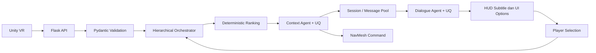
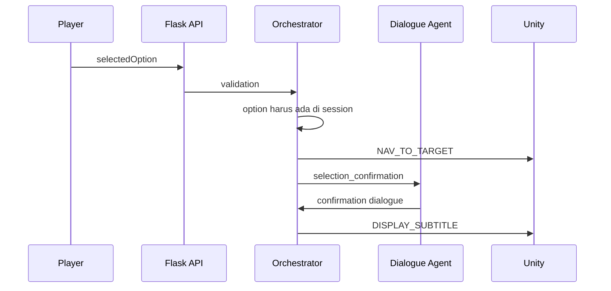

# Materi PPT Teknis: Multi-Agent System untuk NPC Pemandu Museum VR

Dokumen ini disusun sebagai bahan utama pembuatan PPT dan naskah presentasi teknis.
Bahasanya dibuat sederhana, tetapi seluruh penjelasan tetap mengikuti implementasi
terbaru di source code.

Status acuan:

- Project: Multi-Agent VR Museum Guide
- Tanggal hasil utama: 13 Juni 2026
- Agent model: `gpt-5-mini`
- LLM-as-a-Judge: `gpt-5.4`
- Hasil utama: 50 dari 50 skenario lulus
- File hasil: `evals/results/eval_results_20260613_144945.json`

> Catatan penting: nilai 100% berarti seluruh skenario pada test set yang tersedia
> berhasil dilewati. Nilai ini tidak berarti sistem sudah sempurna untuk seluruh
> situasi dunia nyata.

## Rekomendasi Pemakaian

Dokumen ini sengaja lengkap. Untuk presentasi sekitar 15-20 menit, gunakan slide:

```text
1, 2, 3, 4, 5, 6, 10, 13, 15, 16, 19, 22, 25,
30, 31, 34, 39, 40, 41, 42, 47, 49, 50
```

Slide lain dapat ditempatkan sebagai appendix atau digunakan ketika penguji meminta
penjelasan teknis lebih dalam.

---

## Slide 1 - Judul

### Isi slide

**Multi-Agent System untuk NPC Pemandu Budaya pada Museum Virtual Reality**

Subjudul:

**Integrasi Context Agent, Dialogue Agent, Uncertainty Quantification, dan
LLM-as-a-Judge**

### Narasi presenter

Project ini membangun backend untuk NPC pemandu di museum VR. Sistem menerima
kondisi dunia dari Unity, memilih objek budaya yang sesuai, mengarahkan NPC menuju
objek tersebut, lalu menghasilkan dialog dan pilihan tujuan untuk pemain.

---

## Slide 2 - Masalah yang Diangkat

### Isi slide

NPC pemandu pada museum VR harus mampu:

1. Memahami posisi dan keadaan pemain.
2. Mengetahui objek yang sudah atau belum dikunjungi.
3. Memilih tujuan yang relevan.
4. Memberikan arahan yang jelas dan natural.
5. Tidak mengarang informasi atau membocorkan data teknis.

### Narasi presenter

Jika seluruh proses diberikan kepada LLM, model dapat salah menghitung jarak,
memilih objek yang sudah dikunjungi, atau menghasilkan dialog yang tidak sesuai
dengan target navigasi. Karena itu, project ini membagi pekerjaan antara komponen
deterministic dan agent berbasis LLM.

---

## Slide 3 - Tujuan Sistem

### Isi slide

Tujuan project:

- Menghubungkan Unity VR dengan backend agent.
- Menghasilkan rekomendasi maksimal tiga objek budaya.
- Menentukan target navigasi NPC.
- Menghasilkan dialog berbahasa Indonesia.
- Menampilkan subtitle dan pilihan tujuan pada UI.
- Mengukur kestabilan output LLM.
- Mengevaluasi sistem secara otomatis.

### Narasi presenter

Sistem tidak hanya menghasilkan teks. Hasil agent dipakai untuk tindakan di dalam
VR, sehingga akurasi target, konsistensi data, dan keamanan output menjadi bagian
penting dari desain.

---

## Slide 4 - Perjalanan Pengembangan Project

### Isi slide

| Tahap | Perkembangan |
|---|---|
| April 2026 | Project awal dibuat |
| Mei 2026 | Arsitektur diubah menjadi dua agent |
| Mei 2026 | Data cultural site dan selection API ditambahkan |
| Mei 2026 | Input live dari Unity dan API context-dialogue dipisahkan |
| Mei 2026 | Context Agent dibatasi dengan runtime tools |
| Mei 2026 | Dialogue Agent diperkuat dengan few-shot prompting |
| Juni 2026 | Evaluation suite dan 50 skenario ditambahkan |
| Juni 2026 | UQ diterapkan pada kedua agent |
| Juni 2026 | LLM Judge dipisahkan dari model agent |
| 13 Juni 2026 | Evaluator dan output agent diperbaiki, 50/50 skenario lulus |

### Narasi presenter

Project berkembang dari prototype sederhana menjadi arsitektur hybrid. Guidance
Agent yang lama tidak lagi digunakan karena navigasi lebih tepat dikerjakan oleh
Unity NavMesh. Sistem akhir menggunakan Context Agent dan Dialogue Agent.

---

## Slide 5 - Mengapa Disebut Multi-Agent System?

### Isi slide

Sistem memiliki dua agent dengan tanggung jawab berbeda:

| Agent | Tugas |
|---|---|
| Context Agent | Menyusun konteks keadaan dan alasan rekomendasi |
| Dialogue Agent | Mengubah konteks menjadi dialog dan UI |

Keduanya:

- memiliki system prompt berbeda;
- memiliki peran berbeda;
- menghasilkan output terstruktur;
- berkomunikasi melalui `ContextOutput`;
- dikoordinasikan oleh orchestrator.

Secara hierarki:

```text
Dialogue Agent = parent / synthesiser
Context Agent  = child / context publisher
```

### Narasi presenter

Sistem ini bukan sekadar dua kali memanggil LLM. Setiap agent memiliki fungsi,
schema, metode uncertainty, dan aturan evaluasi yang berbeda.

---

## Slide 6 - Jenis Arsitektur

### Isi slide

**Hybrid deterministic + LLM multi-agent architecture**



### Narasi presenter

Disebut hybrid karena LLM hanya dipakai pada bagian interpretatif dan bahasa.
Filtering, perhitungan jarak, ranking, dan target navigasi tetap dihitung secara
deterministic agar hasilnya konsisten.

---

## Slide 7 - Teknologi yang Digunakan

### Isi slide

| Area | Teknologi |
|---|---|
| Bahasa | Python 3.11+ |
| Web API | Flask |
| Data validation | Pydantic |
| Agent framework | Strands Agents |
| LLM API | OpenAI-compatible API / Azure |
| Agent model | `gpt-5-mini` |
| Judge model | `gpt-5.4` |
| Testing | `unittest` |
| Evaluasi statistik | NumPy, SciPy, scikit-learn |
| Visualisasi | Matplotlib |
| Dependency management | `uv` |
| API manual testing | Postman |

### Narasi presenter

Agent dan judge menggunakan endpoint OpenAI-compatible. Konfigurasi juga dapat
mengubah endpoint Azure Foundry menjadi format `/openai/v1/` yang kompatibel.

---

## Slide 8 - Struktur Project

### Isi slide

```text
my-project/
  main.py                         Flask API
  src/
    agents/
      context_agent.py            Context Agent dan Context UQ
      dialogue_agent.py           Dialogue Agent dan Dialogue UQ
    orchestration/
      coordinator.py              Orchestrator dan ranking
    schema/
      models.py                   Pydantic schema
    core/
      config.py                   Konfigurasi model
      mock_model.py               Model offline
    vr_tools/
      unity_api.py                Bridge Unity
      vr_actions.py               NavMesh dan subtitle
      vr_perception.py            Helper perception
  evals/
    scenarios.json                50 skenario utama
    uq_failure_scenarios.json     20 skenario UQ
    judge_validation_cases.json   Validasi judge
    run_agent_evaluation.py       Evaluation runner
  tests/                          Unit dan integration tests
  docs/                           Dokumentasi dan gambar
```

### Narasi presenter

`main.py` adalah server utama. `server.py` hanya template FastAPI lama dan tidak
digunakan oleh alur MAS saat ini. `test.tsx` juga tidak menjadi bagian dari runtime.

---

## Slide 9 - Unity sebagai Source of Truth

### Isi slide

Unity menjadi sumber kebenaran untuk:

- `timestamp`;
- scene aktif;
- posisi pemain;
- daftar objek budaya;
- koordinat objek;
- status `visited`.

Backend tidak otomatis menandai objek sebagai telah dikunjungi.

### Narasi presenter

Ketika pemain benar-benar sampai pada objek, Unity harus mengirim snapshot baru
dengan `visited=true`. Backend hanya memproses keadaan terbaru yang diberikan pada
request.

---

## Slide 10 - Alur API Utama

### Isi slide

```text
1. POST /context/run
   Unity mengirim snapshot -> backend membuat rekomendasi dan nav_target

2. POST /dialogue/run
   Backend membaca session -> agent membuat dialog dan UI

3. POST /recommendation/select
   Pemain memilih opsi -> backend mengubah target dan membuat konfirmasi
```

Endpoint tambahan:

- `GET /user/status`
- `GET /world/cultural_sites`
- `PUT /world/cultural_sites`
- `POST /run-simulation` sebagai endpoint legacy

### Narasi presenter

Alur baru memisahkan Context Agent dan Dialogue Agent agar setiap tahap dapat
dikontrol, diuji, dan dipanggil secara terpisah.

---

## Slide 11 - Contoh Input dari Unity

### Isi slide

```json
{
  "timestamp": "2026-06-13T12:00:00Z",
  "scene": "Heritage_Museum_Wing_A",
  "playerPosition": "0, 0, 0",
  "culturalSites": [
    {
      "id": "Angklung",
      "name": "Angklung",
      "cultural_position": "2, 0, 0",
      "visited": false
    }
  ]
}
```

Alias yang didukung:

- `culturalObject`, `culturalObjects`, atau `cultural_sites`;
- `coordinate` menjadi `cultural_position`;
- `isObjectVisited` menjadi `visited`.

### Narasi presenter

Alias disediakan untuk kompatibilitas dengan beberapa bentuk payload Unity yang
pernah digunakan selama pengembangan.

---

## Slide 12 - Validasi Data dengan Pydantic

### Isi slide

Pydantic memeriksa:

- field wajib tidak kosong;
- posisi pemain berbentuk `"x, y, z"`;
- koordinat dapat diubah menjadi angka;
- cultural site memiliki ID, nama, posisi, dan status;
- input dan output agent sesuai schema.

Contoh response error:

```text
400 = JSON atau session tidak valid
422 = struktur request tidak sesuai schema
500 = error internal
```

### Narasi presenter

Validasi dilakukan sebelum request masuk ke agent. Dengan demikian LLM tidak
dipaksa menangani payload yang strukturnya rusak.

---

## Slide 13 - Deterministic Recommendation Engine

### Isi slide

Proses ranking:

1. Ambil objek dengan `visited=false`.
2. Hitung jarak pemain ke setiap objek.
3. Urutkan dari jarak paling dekat.
4. Jika jaraknya sama, urutkan berdasarkan nama.
5. Ambil maksimal tiga rekomendasi.
6. Rank-1 menjadi `nav_target`.

Rumus:

```text
distance =
sqrt((px - sx)^2 + (py - sy)^2 + (pz - sz)^2)
```

### Narasi presenter

Ranking sengaja tidak diberikan kepada LLM karena masalah ini bersifat numerik dan
memiliki satu jawaban objektif. Keputusan navigasi harus reproducible.

---

## Slide 14 - Mengapa Tidak Semua Diproses LLM?

### Isi slide

| Deterministic | LLM |
|---|---|
| Validasi payload | Interpretasi konteks |
| Filter `visited` | Alasan rekomendasi |
| Hitung jarak | Gaya dialog |
| Ranking top-3 | Ringkasan untuk pemain |
| `nav_target` | Persona NPC |
| Validasi pilihan | Bahasa natural |

### Narasi presenter

Pembagian ini mengurangi hallucination. LLM dipakai untuk hal yang membutuhkan
fleksibilitas bahasa, sedangkan aturan yang bisa dihitung secara pasti tetap
dikerjakan oleh program.

---

## Slide 15 - Context Agent

### Isi slide

Peran Context Agent:

- membaca bounded runtime snapshot;
- memahami keadaan pemain;
- mengklasifikasikan situasi;
- membuat alasan rank-1;
- menentukan intent untuk Dialogue Agent;
- menghasilkan `ContextOutput`.

Field interpretatif:

```text
user_action
context_summary
situation_type
recommendation_reason
dialogue_intent
```

### Narasi presenter

Context Agent bukan recommender bebas. Rekomendasi dan target sudah dihitung oleh
backend. Agent berfungsi sebagai bounded context-synthesis agent.

---

## Slide 16 - ReAct dan Bounded Tools

### Isi slide

Context Agent mengikuti pola:

```text
Reasoning -> Action -> Observation -> Synthesis
```

Bounded tools:

1. `tool_get_runtime_user_status`
2. `tool_get_runtime_cultural_sites`
3. `tool_get_runtime_recommendations`

### Narasi presenter

Tool hanya membaca snapshot request aktif di memory. Tool tidak mengakses internet,
database, atau sumber lain. Hal ini menjaga agent tetap grounded pada data Unity.

---

## Slide 17 - ContextOutput

### Isi slide

```json
{
  "timestamp": "...",
  "scene": "...",
  "user_action": "...",
  "context_summary": "...",
  "situation_type": "multiple_recommendations",
  "recommendation_reason": "...",
  "dialogue_intent": "guide_to_primary_with_alternatives",
  "recommendations": [],
  "nav_target": "Angklung"
}
```

Jenis situasi:

- `multiple_recommendations`
- `single_recommendation`
- `all_sites_visited`
- `exploration_context`

### Narasi presenter

Output ini menjadi kontrak komunikasi antara Context Agent, Dialogue Agent,
orchestrator, NavMesh, dan session store.

---

## Slide 18 - Guardrail Context Agent

### Isi slide

Backend mengunci kembali:

- `timestamp`;
- `scene`;
- daftar rekomendasi;
- urutan rekomendasi;
- `nav_target`;
- deskripsi keadaan yang aman.

Alasan rekomendasi diterima hanya jika:

- menyebut target rank-1;
- menjelaskan target sebagai yang terdekat atau satu-satunya;
- tidak menyebut objek di luar rekomendasi.

### Narasi presenter

Walaupun LLM mengubah field kritis, orchestrator akan menggantinya dengan nilai
hasil perhitungan backend. Jika JSON gagal diproses, sistem menggunakan fallback.

---

## Slide 19 - Context Agent Uncertainty Quantification

### Isi slide

Context Agent dijalankan tiga kali untuk input yang sama.

Field yang dibandingkan:

- `user_action`
- `context_summary`
- `recommendation_reason`
- `situation_type`
- `dialogue_intent`

```text
CDeg_i = rata-rata similarity sample i terhadap sample lain

UDeg = 1 - rata-rata seluruh CDeg
```

Sample dengan `CDeg` tertinggi dipilih.

### Narasi presenter

Metode ini disebut black-box consistency-based UQ karena tidak membutuhkan logit
atau probabilitas token. Sistem cukup membandingkan beberapa output akhir.

---

## Slide 20 - Message Pool dan Session

### Isi slide

`InMemoryMessagePool` menyimpan:

- context terakhir;
- dialogue terakhir;
- history message;
- session berdasarkan `simulation_id`.

Isi session:

```text
simulation_id
player_position
cultural_sites
context
dialogue
```

### Narasi presenter

Session memastikan `/dialogue/run` memakai context dari simulation ID yang benar,
bukan sekadar context global paling baru. Kelemahannya, seluruh session hilang jika
server restart karena belum memakai database.

---

## Slide 21 - Dispatch ke NavMesh

### Isi slide

Jika `nav_target` tersedia:

```json
{
  "command": "NAV_TO_TARGET",
  "target_id": "Angklung"
}
```

Jika seluruh objek telah dikunjungi:

```text
recommendations = []
nav_target = ""
navmesh_ack = false
```

### Narasi presenter

Backend hanya mengirim identitas target. Proses pencarian jalur dan gerakan NPC
dikerjakan oleh Unity NavMesh.

---

## Slide 22 - Dialogue Agent

### Isi slide

Persona NPC:

- Nama: Arif
- Peran: pemandu budaya
- Gaya: ramah, hangat, ringkas, dan meyakinkan

Input:

```text
ContextOutput dari session
```

Output:

```text
spoken_output
subtitle_output
recommendation_dialogue
recommendation_options
```

### Narasi presenter

Dialogue Agent tidak melakukan ranking. Ia mengubah output Context Agent menjadi
bahasa yang mudah dipahami pemain.

---

## Slide 23 - Few-Shot Prompting pada Dialogue Agent

### Isi slide

Prompt memiliki contoh untuk:

1. beberapa rekomendasi;
2. satu rekomendasi;
3. semua objek sudah dikunjungi;
4. konfirmasi pilihan pemain.

Aturan utama:

- subtitle maksimal 15 kata;
- opsi mengikuti urutan context;
- target utama harus disebut;
- tidak menampilkan koordinat atau istilah teknis;
- tidak mengarang fakta budaya.

### Narasi presenter

Few-shot prompting membantu model memahami format JSON dan gaya jawaban yang
diharapkan. Namun hasilnya tetap diverifikasi oleh UQ dan orchestrator.

---

## Slide 24 - DialogueOutput

### Isi slide

```json
{
  "spoken_output": "Mari mulai dari Angklung...",
  "subtitle_output": "Mari menuju Angklung.",
  "recommendation_dialogue": "Tersedia tiga rekomendasi teratas...",
  "recommendation_options": [
    "Angklung",
    "Surabi",
    "Kujang"
  ]
}
```

### Narasi presenter

Pada implementasi VR saat ini, bagian yang benar-benar berpengaruh ke HUD adalah
subtitle, recommendation dialogue, dan recommendation options. `spoken_output`
tetap dipertahankan untuk kompatibilitas API, tetapi audio/TTS belum digunakan.

---

## Slide 25 - Dialogue Agent UQ

### Isi slide

Kemiripan antar kandidat:

```text
a_ij =
0.50 * similarity(recommendation_dialogue)
+ 0.30 * similarity(subtitle)
+ 0.20 * similarity(options)
```

Grounding score:

```text
0.50 * option_score
+ 0.35 * primary_target_score
+ 0.15 * subtitle_score
```

Pemilihan akhir:

```text
FinalScore = 0.45 * CDeg + 0.55 * grounding_score
```

### Narasi presenter

Konsistensi saja tidak cukup. Tiga jawaban dapat sama-sama konsisten tetapi salah
target. Karena itu grounding diberi bobot lebih besar.

---

## Slide 26 - Safe Fallback Dialogue

### Isi slide

Fallback digunakan jika:

- JSON agent gagal diproses;
- target utama tidak disebut;
- `CDeg` rendah dan grounding tidak sempurna;
- subtitle pilihan tidak menyebut opsi yang dipilih.

Contoh fallback:

```text
"Mari menuju Angklung."
```

### Narasi presenter

Fallback menghasilkan dialog sederhana tetapi aman. Dalam sistem navigasi, jawaban
yang sederhana dan benar lebih baik daripada jawaban kreatif tetapi salah.

---

## Slide 27 - Selection Flow

### Isi slide



### Narasi presenter

Pemain hanya dapat memilih objek yang sedang aktif dalam rekomendasi. Pilihan
asing atau session yang tidak dikenal akan ditolak dengan HTTP 400.

---

## Slide 28 - Integrasi Unity Saat Ini

### Isi slide

Command yang disiapkan:

```text
NAV_TO_TARGET
DISPLAY_SUBTITLE
```

Kondisi implementasi:

- kontrak request dan command sudah tersedia;
- log pengiriman command sudah berjalan;
- `UnityAPIClient.post()` saat ini masih simulasi;
- fungsi tersebut selalu mengembalikan `True`;
- real HTTP call ke Unity belum diaktifkan.

### Narasi presenter

Ini adalah batasan penting. Hasil evaluasi membuktikan logika backend dan kontrak
data, tetapi belum membuktikan keberhasilan jaringan dan gerakan NPC pada build
Unity sesungguhnya.

---

## Slide 29 - Mode Mock dan Mode Real LLM

### Isi slide

Mode mock:

```text
USE_MOCK_MODEL=true
```

- tidak membutuhkan internet;
- cepat dan deterministic;
- cocok untuk integration test.

Mode real:

```text
USE_MOCK_MODEL=false
OPENROUTER_MODEL=gpt-5-mini
```

- memanggil Azure/OpenAI-compatible endpoint;
- menghasilkan variasi bahasa nyata;
- digunakan pada evaluasi final.

### Narasi presenter

Jika credential tidak tersedia, orchestrator dapat kembali menggunakan MockModel.
Pada evaluasi utama, log menunjukkan model eksternal `gpt-5-mini` benar-benar
digunakan.

---

## Slide 30 - Strategi Evaluasi

### Isi slide

Evaluasi menggunakan tiga lapis:

1. **Deterministic checks**
   - memeriksa aturan yang memiliki jawaban pasti.
2. **LLM-as-a-Judge**
   - menilai kualitas bahasa dan reasoning.
3. **Controlled validation**
   - menguji apakah judge dan UQ dapat mengenali output rusak.

### Narasi presenter

Pendekatan hybrid dipakai karena Context Agent memiliki aspek objektif, sedangkan
Dialogue Agent memiliki aspek bahasa yang tidak bisa dinilai hanya dengan exact
match.

---

## Slide 31 - Dataset 50 Skenario

### Isi slide

| Kelompok | Jumlah |
|---|---:|
| Context normal | 15 |
| Context edge case | 10 |
| Dialogue normal | 15 |
| Dialogue risk | 10 |
| **Total** | **50** |

Setiap skenario menggunakan delapan objek:

```text
Surabi, Angklung, Julang Ngapak, Kujang,
Badak Heuay, Tagog Anjing, Tari Jaipong, Suling Sunda
```

### Narasi presenter

Skenario memvariasikan posisi pemain, status visited, jumlah target tersisa,
semua objek telah dikunjungi, alias payload, pilihan valid, pilihan invalid, dan
risiko dialog.

---

## Slide 32 - Deterministic Checks

### Isi slide

Context checks:

- schema valid;
- tidak merekomendasikan objek visited;
- ranking sama dengan gold calculation;
- `nav_target` sama dengan rank-1;
- maksimal tiga rekomendasi;
- interpretive fields tidak membocorkan koordinat.

Dialogue checks:

- schema valid;
- subtitle maksimal 15 kata;
- opsi sama dengan context;
- target utama disebut;
- tidak ada token teknis;
- pilihan invalid ditolak.

### Narasi presenter

Gold ranking dihitung kembali oleh evaluator menggunakan aturan yang sama:
filter visited, Euclidean distance, tie-break nama, dan top-3.

---

## Slide 33 - Information Retrieval Metrics

### Isi slide

| Metrik | Arti sederhana |
|---|---|
| Precision@3 | Apakah tiga rekomendasi yang muncul relevan |
| Recall@3 | Berapa bagian seluruh objek relevan yang tercakup |
| MRR | Seberapa cepat objek relevan muncul di urutan atas |
| NDCG@3 | Seberapa baik kualitas urutan top-3 |

Hasil:

```text
Precision@3 = 1.0000
Recall@3    = 0.6252
MRR         = 0.9600
NDCG@3      = 0.9400
```

### Narasi presenter

Recall lebih rendah bukan berarti ranking buruk. Sistem memang hanya menampilkan
maksimal tiga objek, sedangkan jumlah objek yang belum dikunjungi dapat lebih banyak.

---

## Slide 34 - Desain LLM-as-a-Judge

### Isi slide

Konfigurasi:

```text
Agent = gpt-5-mini
Judge = gpt-5.4
Judge reasoning_effort = minimal
```

Prinsip:

- model agent dan judge dipisahkan;
- semua dimensi dinilai dalam satu panggilan per skenario;
- skor harus integer 1 sampai 5;
- setiap skor wajib memiliki reasoning;
- response invalid di-retry;
- error judge dianggap gagal atau fail-closed.

### Narasi presenter

Model judge yang lebih kuat dipilih untuk menilai agent yang lebih kecil. Pemisahan
ini mengurangi risiko model menilai output miliknya sendiri. Ringkasan evaluator
mencatat `judge_temperature=0`, tetapi request GPT-5 tidak mengirim parameter
temperature secara eksplisit karena konfigurasi kompatibilitas model memakai
`max_completion_tokens` dan `reasoning_effort`.

---

## Slide 35 - Scope yang Benar untuk Judge

### Isi slide

Payload evaluator dipisahkan menjadi:

```text
reference
grounding_reference
candidate_under_test
```

Khusus `technical_leak_safety`, judge hanya menilai:

- `spoken_output`;
- `subtitle_output`;
- `recommendation_dialogue`;
- `recommendation_options`.

### Narasi presenter

Sebelumnya judge ikut menghukum koordinat yang berada pada ContextOutput internal,
padahal koordinat tersebut tidak tampil kepada pemain. Scope kemudian diperbaiki
agar judge membedakan data internal dan output user-facing.

---

## Slide 36 - Dimensi LLM Judge

### Isi slide

Context Agent:

- grounded correctness;
- context relevance;
- faithfulness;
- user action quality;
- recommendation reason quality;
- interpretation consistency.

Dialogue Agent:

- grounded correctness;
- context relevance;
- faithfulness;
- navigation clarity;
- persona alignment;
- language quality;
- UI usefulness;
- technical leak safety.

### Narasi presenter

Threshold umum adalah 4 dari 5. Tiga dimensi menjadi hard gate:

```text
grounded correctness >= 4
faithfulness >= 4
technical leak safety = 5
```

---

## Slide 37 - Validasi LLM Judge

### Isi slide

Benchmark judge:

- 3 output bersih;
- 3 output yang sengaja dirusak;
- target salah;
- hallucination dan technical leak;
- prompt injection.

Hasil:

```text
Coverage                = 100%
Label accuracy          = 100%
Clean-pass sensitivity  = 100%
Corruption specificity  = 100%
```

### Narasi presenter

Benchmark ini menunjukkan bahwa judge dapat membedakan kontrol bersih dan corruption
yang disediakan. Jumlah enam kasus masih kecil, sehingga human validation tetap
diperlukan.

---

## Slide 38 - Evaluasi UQ pada Run Utama

### Isi slide

Pada 50 skenario utama:

```text
Context mean UDeg  = 0.0984
Dialogue mean UDeg = 0.2812
```

Semua output benar:

```text
AUARC = 1.0
Error-detection AUROC = tidak dapat dihitung
```

### Narasi presenter

AUROC membutuhkan dua kelas, yaitu output benar dan salah. Karena semua skenario
utama benar, evaluator tidak dapat mengukur kemampuan UQ membedakan error hanya
dari run utama.

---

## Slide 39 - Controlled UQ Failure Validation

### Isi slide

Benchmark tambahan:

| Agent | Clean | Corrupted |
|---|---:|---:|
| Context | 5 | 5 |
| Dialogue | 5 | 5 |

Hasil:

| Metrik | Context | Dialogue |
|---|---:|---:|
| Error AUROC | 1.0000 | 1.0000 |
| Mean UDeg benar | 0.2531 | 0.2378 |
| Mean UDeg salah | 0.9765 | 0.3661 |
| Mann-Whitney p | 0.003747 | 0.004850 |

### Narasi presenter

Output yang sengaja dibuat salah memiliki uncertainty lebih tinggi. Namun ini
merupakan controlled stress test, bukan bukti bahwa seluruh error alami akan selalu
terdeteksi.

---

## Slide 40 - Hasil Awal Setelah Judge gpt-5.4

### Isi slide

Hasil sebelum perbaikan:

```text
Deterministic check pass = 100%
Overall pass rate        = 20%
Technical safety pass    = 8%
Faithfulness pass        = 54%
```

Masalah ditemukan:

1. Judge menghukum metadata internal.
2. Sistem mengatakan "3 objek belum dikunjungi".
3. Angka 3 sebenarnya jumlah rekomendasi top-3.
4. Alasan "sesuai urutan rekomendasi" terlalu lemah.
5. `user_action` kadang terlalu spekulatif.

### Narasi presenter

Nilai rendah tidak langsung dianggap sebagai kegagalan agent. Reasoning judge
diperiksa untuk membedakan bug sistem nyata dan kesalahan desain evaluator.

---

## Slide 41 - Perbaikan yang Dilakukan

### Isi slide

Perbaikan evaluator:

- pisahkan candidate dan grounding reference;
- safety hanya menilai output user-facing;
- pertahankan hard gate tanpa menurunkan threshold.

Perbaikan agent:

- gunakan "3 rekomendasi teratas";
- hindari klaim jumlah total objek;
- alasan rank-1 harus menjelaskan jarak terdekat;
- `user_action` hanya memakai fakta yang tersedia;
- tambahkan fallback dan regression tests.

### Narasi presenter

Tujuannya bukan memanipulasi skor. Tujuannya memperbaiki definisi evaluasi dan
menghilangkan klaim yang memang tidak didukung data.

---

## Slide 42 - Hasil Evaluasi Final

### Isi slide

```text
Total skenario           = 50
Skenario lulus           = 50
Overall pass rate        = 100%
Deterministic check rate = 100%
Judge coverage           = 350/350
Judge error              = 0
Mean judge score         = 4.7942 / 5
```

### Narasi presenter

Seluruh 50 skenario berhasil pada test set setelah scope evaluator dan output agent
diperbaiki. Agent tetap menggunakan `gpt-5-mini`, sedangkan judge menggunakan
`gpt-5.4`.

---

## Slide 43 - Detail Skor Final

### Isi slide

| Dimensi | Mean |
|---|---:|
| Grounded correctness | 4.98 |
| Context relevance | 4.96 |
| Faithfulness | 4.96 |
| User action quality | 4.00 |
| Recommendation reason | 4.96 |
| Interpretation consistency | 5.00 |
| Navigation clarity | 4.52 |
| Persona alignment | 4.04 |
| Language quality | 4.80 |
| UI usefulness | 4.96 |
| Technical leak safety | 5.00 |

### Narasi presenter

Nilai terendah masih berada pada `user_action_quality` dan `persona_alignment`.
Keduanya lulus, tetapi masih menjadi ruang peningkatan.

---

## Slide 44 - Automated Tests

### Isi slide

Hasil test suite:

```text
34 tests passed
1 live Azure test skipped
```

Yang diuji:

- config Azure dan parameter GPT-5;
- API context-dialogue-selection;
- session isolation;
- all-sites-visited;
- invalid payload dan invalid option;
- UQ metrics dan fault injection;
- LLM Judge parsing, retry, fail-closed, dan scope safety;
- perbaikan wording context.

### Narasi presenter

Live Azure test dibuat opt-in melalui `RUN_AZURE_INTEGRATION=true` agar test normal
tidak selalu menghabiskan API quota.

---

## Slide 45 - Output Visualisasi

### Isi slide

Evaluator menghasilkan:

1. deterministic check pass rate;
2. Dialogue Agent radar;
3. Context Agent radar;
4. scenario metric heatmap;
5. reliability boxplot;
6. ablation delta;
7. IR metrics summary;
8. UQ accuracy-rejection curve;
9. UQ error detection.

Lokasi:

```text
evals/figures/
```

### Visual yang disarankan untuk PPT

- `docs/figures/latest_system_architecture.png`
- `evals/figures/02_dialogue_agent_radar.png`
- `evals/figures/03_context_agent_radar.png`
- `evals/figures/04_scenario_metric_heatmap.png`
- `evals/figures/07_ir_metrics_summary.png`
- `evals/figures/09_uq_error_detection.png`

---

## Slide 46 - Kelebihan Sistem

### Isi slide

- Keputusan navigasi tidak diserahkan penuh kepada LLM.
- Agent memiliki tugas dan schema yang jelas.
- Input agent dibatasi pada snapshot runtime.
- Output memiliki fallback aman.
- Session menjaga konsistensi antar-endpoint.
- UQ memilih kandidat yang stabil dan grounded.
- Evaluasi mencakup deterministic checks dan kualitas bahasa.
- Model agent dan judge dipisahkan.
- Seluruh hasil dan reasoning judge disimpan sebagai JSON.

### Narasi presenter

Kekuatan utama project adalah pemisahan tanggung jawab. Sistem tetap memperoleh
fleksibilitas LLM tanpa mengorbankan aturan navigasi yang objektif.

---

## Slide 47 - Keterbatasan Sistem

### Isi slide

1. Unity bridge masih simulasi, belum real HTTP.
2. Session hanya disimpan di memory.
3. Server restart akan menghapus session.
4. Belum ada database, authentication, dan rate limiting.
5. Belum ada pengukuran latency end-to-end.
6. Sampling tiga kali meningkatkan biaya dan waktu respons.
7. Registry lokal hanya memiliki dua objek.
8. Delapan objek benchmark berasal dari payload skenario.
9. Belum ada anotasi manusia.
10. Test set berukuran 50 skenario.
11. Audio/TTS belum digunakan.

### Narasi presenter

Bagian ini penting agar klaim penelitian tetap proporsional. Hasil kuat pada
benchmark tidak otomatis sama dengan kesiapan production.

---

## Slide 48 - Validitas dan Ancaman Bias

### Isi slide

Risiko validitas:

- test set dapat terlalu dekat dengan proses pengembangan;
- LLM Judge dapat memiliki bias;
- corruption benchmark masih kecil;
- model dari keluarga serupa dapat memiliki preferensi serupa;
- seluruh skenario utama benar sehingga natural-error AUROC belum tersedia;
- hasil dapat berubah jika model provider atau deployment berubah.

Mitigasi yang sudah ada:

- deterministic gold checks;
- judge model berbeda;
- temperature judge 0;
- clean-vs-corrupted validation;
- reasoning per dimensi;
- fail-closed evaluator.

---

## Slide 49 - Pengembangan Selanjutnya

### Isi slide

Prioritas berikutnya:

1. Hubungkan `UnityAPIClient` dengan HTTP Unity sesungguhnya.
2. Tambahkan database session dan logging.
3. Ukur latency, token, dan biaya.
4. Tambahkan authentication dan rate limiting.
5. Uji dengan skenario baru yang tidak dipakai saat pengembangan.
6. Kumpulkan 20-30 anotasi manusia.
7. Lakukan user study dalam VR.
8. Kalibrasi threshold UQ pada validation set terpisah.
9. Tingkatkan persona Arif dan kualitas `user_action`.
10. Tambahkan natural failure dari repeated model runs.

### Narasi presenter

Tahap berikutnya berpindah dari validasi backend menuju validasi pengalaman pengguna
dan integrasi nyata dengan Unity.

---

## Slide 50 - Kesimpulan

### Isi slide

Project berhasil membangun:

- backend MAS dua agent;
- rekomendasi spasial yang deterministic;
- context reasoning berbasis bounded ReAct;
- dialogue generation berbasis persona dan few-shot;
- UQ untuk memilih output yang stabil;
- guardrail dan fallback;
- API flow hingga selection;
- evaluation suite dengan 50 skenario;
- LLM Judge independen.

Hasil utama:

```text
50/50 skenario lulus
Mean judge score 4.7942/5
Precision@3 1.00
Technical safety 5.00
```

### Narasi presenter

Kesimpulan yang aman adalah: sistem berhasil pada seluruh skenario benchmark yang
disediakan dan menunjukkan integrasi yang kuat antara aturan deterministic dan
agent LLM. Sistem belum boleh disebut sempurna karena masih membutuhkan real Unity
integration dan validasi manusia.

---

# Bagian Demo

## Slide 51 - Skenario Demo yang Disarankan

### Isi slide

Demo 1, beberapa rekomendasi:

1. Kirim posisi pemain dan delapan cultural sites.
2. Tunjukkan top-3 dan `nav_target`.
3. Jalankan Dialogue Agent.
4. Pilih opsi rank-2.
5. Tunjukkan `nav_target` berubah.

Demo 2, semua objek visited:

1. Kirim semua `visited=true`.
2. Tunjukkan `recommendations=[]`.
3. Tunjukkan tidak ada NavMesh dispatch.
4. Tunjukkan subtitle aman.

Demo 3, invalid selection:

1. Kirim opsi yang tidak aktif.
2. Tunjukkan backend mengembalikan error 400.

---

## Slide 52 - Command Demo

Menjalankan server:

```bash
cd /Users/dicky/Documents/University/Skripsi/MultiAgent/AgentFinal/my-project
env USE_MOCK_MODEL=false PYTHONPATH=src .venv/bin/python main.py
```

Menjalankan seluruh test:

```bash
.venv/bin/python -m unittest discover -s tests -p 'test_*.py'
```

Menjalankan 50 skenario:

```bash
env USE_MOCK_MODEL=false CONTEXT_UQ_SAMPLES=3 DIALOGUE_UQ_SAMPLES=3 \
PYTHONPATH=src .venv/bin/python evals/run_agent_evaluation.py \
--agent all --judge-coverage all --json
```

Menjalankan validasi UQ:

```bash
env USE_MOCK_MODEL=false CONTEXT_UQ_SAMPLES=3 DIALOGUE_UQ_SAMPLES=3 \
PYTHONPATH=src .venv/bin/python evals/run_agent_evaluation.py \
--uq-failure-validation --agent all --skip-llm-judge
```

---

# Appendix Teknis

## Appendix A - Kontrak API Ringkas

### `/context/run`

Input:

```text
timestamp, scene, playerPosition, culturalSites
```

Output:

```text
simulation_id, ContextOutput, navmesh_ack
```

### `/dialogue/run`

Input:

```text
simulationId
```

Output:

```text
simulation_id, DialogueOutput
```

### `/recommendation/select`

Input:

```text
simulationId, selectedOption
```

Output:

```text
selected_option, selected_site_id, navmesh_ack,
spoken_output, subtitle_output
```

---

## Appendix B - Alur End-to-End Detail

```text
Unity membuat snapshot
-> Flask menerima JSON
-> Pydantic menormalisasi alias
-> Pydantic memvalidasi koordinat
-> Orchestrator membangun EnvironmentSnapshot
-> Backend memfilter visited
-> Backend menghitung jarak
-> Backend mengambil top-3
-> Context Agent membuat 3 kandidat
-> Context UQ memilih kandidat paling stabil
-> Orchestrator mengunci field kritis
-> ContextOutput disimpan
-> NavMesh command dikirim
-> simulation_id dibuat
-> Dialogue Agent membaca session
-> Dialogue Agent membuat 3 kandidat
-> Dialogue UQ menghitung CDeg dan grounding
-> Kandidat terbaik dipilih atau fallback digunakan
-> recommendation_options dikunci ke context
-> subtitle dikirim
-> pemain memilih opsi
-> pilihan divalidasi
-> target dan dialog konfirmasi diperbarui
```

---

## Appendix C - Cara Menjelaskan CDeg dan UDeg

Versi sederhana:

```text
CDeg tinggi:
Jawaban ini mirip dengan sebagian besar jawaban lain.

UDeg rendah:
Model cukup stabil untuk input tersebut.

UDeg tinggi:
Jawaban model berubah-ubah, sehingga sistem perlu lebih hati-hati.
```

Analogi:

> Jika tiga orang memberi jawaban yang hampir sama, tingkat keyakinan lebih tinggi.
> Jika tiga jawaban sangat berbeda, tingkat ketidakpastiannya lebih tinggi.

---

## Appendix D - Cara Menjelaskan Nilai 100%

Gunakan kalimat:

> Sistem mencapai tingkat kelulusan 100% pada 50 skenario pengujian yang telah
> ditentukan, dengan skor rata-rata LLM Judge sebesar 4,7942 dari 5.

Hindari kalimat:

> Sistem sudah sempurna dan tidak pernah salah.

Alasannya:

- dataset terbatas;
- real Unity belum diuji penuh;
- belum ada human annotation;
- model dapat berubah;
- situasi dunia nyata lebih beragam.

---

## Appendix E - Pertanyaan Penguji dan Jawaban

### 1. Mengapa ranking tidak dilakukan oleh Context Agent?

Karena ranking berdasarkan jarak memiliki jawaban matematis yang pasti. Jika
diserahkan ke LLM, hasilnya lebih mahal, lebih lambat, dan berisiko salah.

### 2. Jika ranking deterministic, mengapa Context Agent tetap dibutuhkan?

Context Agent menyusun interpretasi keadaan, alasan rekomendasi, tipe situasi, dan
intent dialog. Field tersebut membantu Dialogue Agent menghasilkan respons yang
lebih sesuai konteks.

### 3. Mengapa memakai dua agent?

Pemisahan agent membuat tanggung jawab lebih jelas. Context Agent fokus pada
keadaan dan reasoning, sedangkan Dialogue Agent fokus pada komunikasi dengan pemain.

### 4. Mengapa UQ memakai tiga sampling?

Tiga sampling memberi informasi variasi output dengan biaya yang masih lebih ringan
dibanding sampling dalam jumlah besar. Jumlah ini dapat dikonfigurasi melalui
environment variable.

### 5. Mengapa tidak memakai entropy token?

API black-box tidak selalu menyediakan logit dan probabilitas token. Karena itu,
project memakai consistency-based UQ dari output akhir.

### 6. Mengapa grounding diberi bobot lebih besar dari similarity?

Jawaban yang konsisten belum tentu benar. Grounding memastikan kandidat tetap
menyebut target dan opsi yang berasal dari Context Agent.

### 7. Apakah gpt-5.4 juga menjalankan agent?

Tidak. Agent menggunakan `gpt-5-mini`. `gpt-5.4` hanya digunakan sebagai evaluator
LLM-as-a-Judge.

### 8. Mengapa judge perlu model berbeda?

Untuk mengurangi self-preference, yaitu kecenderungan model menyukai gaya output
milik model yang sama.

### 9. Apakah hasil 100% dapat dipercaya?

Hasil tersebut valid untuk 50 skenario yang diuji. Kepercayaan diperkuat oleh
deterministic checks, judge coverage 100%, dan validasi corruption. Namun masih
perlu human study dan test set baru.

### 10. Mengapa Recall@3 hanya 0.6252?

Karena sistem hanya mengembalikan maksimal tiga rekomendasi. Jika ada lebih dari
tiga objek relevan, tidak semuanya dapat masuk top-3.

### 11. Apakah Unity sudah benar-benar menerima command?

Kontrak command dan logging sudah siap, tetapi `UnityAPIClient.post()` saat ini
masih simulasi. Integrasi HTTP nyata merupakan pengembangan berikutnya.

### 12. Apa kelemahan session saat ini?

Session hanya berada di memory. Jika server restart atau dijalankan pada beberapa
instance, data session tidak otomatis tersedia di instance lain.

### 13. Mengapa `user_action_quality` hanya 4?

Input hanya memberikan posisi dan state, bukan aktivitas detail pemain. Sistem
sengaja memakai deskripsi konservatif agar tidak mengarang tindakan.

### 14. Apa bukti UQ mendeteksi error?

Pada controlled failure benchmark, error AUROC mencapai 1.0 dan rata-rata UDeg
output salah lebih tinggi daripada output benar untuk kedua agent.

### 15. Apa kontribusi teknis utama project?

Kontribusinya adalah integrasi MAS hybrid yang memadukan ranking deterministic,
bounded LLM reasoning, dialogue generation, uncertainty-based selection, fallback,
dan evaluasi multi-lapis untuk konteks NPC museum VR.

---

## Appendix F - Fitur Evaluator Tambahan

Evaluator juga memiliki implementasi:

### Reliability / pass-k

Satu skenario dapat dijalankan berulang sebanyak `k` kali untuk melihat konsistensi
kelulusan dan distribusi skor judge.

```text
pass-k score = jumlah run lulus / k
```

Output dapat divisualisasikan melalui:

```text
evals/figures/05_reliability_boxplot.png
```

### Ablation

Ablation membandingkan:

```text
Run A = context lengkap
Run B = field tertentu dihapus, misalnya recommendation_reason
```

Tujuannya adalah mengukur apakah suatu field benar-benar meningkatkan kualitas
Dialogue Agent.

Output dapat divisualisasikan melalui:

```text
evals/figures/06_ablation_delta.png
```

Catatan:

> Dataset 50 skenario final saat ini tidak memiliki layer `llm_reliability` atau
> `llm_ablation`, sehingga bagian `pass_k` dan `ablation` pada hasil
> `eval_results_20260613_144945.json` bernilai `null`. Fitur evaluasinya tersedia,
> tetapi tidak menjadi bagian dari angka 50/50.

---

## Appendix G - Komponen Pendukung dan Status Penggunaannya

| Komponen | Status |
|---|---|
| `main.py` | Server Flask utama |
| `server.py` | Template FastAPI lama, tidak dipakai MAS |
| `Multi Agent.postman_collection.json` | Tujuh request untuk pengujian API |
| `data/cultural_sites.json` | Registry mock, saat ini berisi Surabi dan Angklung |
| `UnityAPIClient.mark_site_visited()` | Helper tersedia, bukan source of truth flow utama |
| `vr_perception.py` | Helper membaca environment, user status, dan registry mock |
| `tool_show_subtitle()` | Wrapper tersedia, tetapi agent dibuat tanpa tool; dispatch dilakukan orchestrator |
| `MockModel` | Pengujian lokal tanpa biaya API |
| `test.tsx` | File kosong, tidak terhubung ke runtime |
| `Python-3.11.15.tgz.sigstore` | Artefak signature, bukan bagian logika MAS |

### Catatan registry

Registry lokal bukan dataset utama evaluasi. Pada 50 skenario, daftar delapan objek
dikirim langsung melalui request masing-masing, sesuai prinsip Unity sebagai source
of truth.

---

## Appendix H - Konfigurasi Model

Environment variable utama:

```text
USE_MOCK_MODEL
OPENROUTER_API_KEY
OPENROUTER_BASE_URL
OPENROUTER_MODEL
JUDGE_API_KEY
JUDGE_BASE_URL
JUDGE_MODEL
JUDGE_MAX_RETRIES
CONTEXT_UQ_SAMPLES
DIALOGUE_UQ_SAMPLES
DIALOGUE_UQ_MIN_CDEG
```

Kompatibilitas parameter:

| Model | Parameter output |
|---|---|
| GPT-5 family | `max_completion_tokens`, `reasoning_effort` |
| o1/o3/o4 family | `max_completion_tokens`, `reasoning_effort` |
| Model lain | `max_tokens`, `temperature` |

Konfigurasi Azure:

```text
https://RESOURCE.services.ai.azure.com/openai/v1/
```

Jika URL yang diberikan masih berupa project URL Azure, config akan mengubahnya ke
endpoint OpenAI-compatible tersebut.

---

## Appendix I - Source of Truth Dokumen

Bagian materi ini diperiksa terhadap:

| Topik | Source utama |
|---|---|
| Endpoint API | `main.py` |
| Schema data | `src/schema/models.py` |
| Ranking dan session | `src/orchestration/coordinator.py` |
| Context Agent dan Context UQ | `src/agents/context_agent.py` |
| Dialogue Agent dan Dialogue UQ | `src/agents/dialogue_agent.py` |
| Konfigurasi model | `src/core/config.py` |
| Mock LLM | `src/core/mock_model.py` |
| Unity bridge | `src/vr_tools/unity_api.py` |
| Action Unity | `src/vr_tools/vr_actions.py` |
| Skenario utama | `evals/scenarios.json` |
| Evaluation runner | `evals/run_agent_evaluation.py` |
| Validasi UQ | `evals/uq_failure_scenarios.json` |
| Validasi judge | `evals/judge_validation_cases.json` |
| Hasil final | `evals/results/eval_results_20260613_144945.json` |
| Hasil UQ controlled failure | `evals/results/eval_results_20260613_125456.json` |
| Hasil validasi judge | `evals/results/judge_validation_20260613_124524.json` |
| Automated tests | `tests/` |

Dokumen lain di folder `docs/` digunakan sebagai konteks sejarah, tetapi angka dan
status implementasi terbaru selalu mengikuti source code serta hasil evaluasi di
atas.

---

# Ringkasan Presentasi 1 Menit

Project ini adalah backend Multi-Agent System untuk NPC pemandu museum VR. Unity
mengirim posisi pemain, scene, daftar objek budaya, dan status visited. Backend
kemudian memfilter objek yang belum dikunjungi, menghitung jarak Euclidean, dan
memilih maksimal tiga tujuan terdekat. Context Agent membaca snapshot melalui
bounded tools dan menyusun konteks terstruktur. Dialogue Agent mengubah konteks
tersebut menjadi subtitle dan opsi UI dengan persona Arif. Kedua agent menggunakan
Uncertainty Quantification melalui tiga sampling untuk memilih kandidat yang paling
stabil dan grounded. Sistem diuji menggunakan 50 skenario, deterministic checks,
LLM-as-a-Judge `gpt-5.4`, validasi corruption, dan controlled UQ failures. Hasil
akhir menunjukkan 50 dari 50 skenario lulus dengan skor judge rata-rata 4,7942 dari
5. Keterbatasan utamanya adalah bridge Unity masih simulasi, session masih in-memory,
dan belum ada validasi manusia.

---

# Checklist Sebelum Membuat PPT

- Gunakan 15-20 slide utama jika waktu presentasi singkat.
- Pindahkan slide detail ke appendix.
- Masukkan diagram arsitektur pada awal pembahasan teknis.
- Tampilkan tabel hasil final, bukan seluruh JSON.
- Jelaskan peningkatan 20% ke 100% bersama akar masalahnya.
- Jangan menyebut sistem sempurna.
- Nyatakan bahwa Unity bridge masih mock/simulasi.
- Nyatakan bahwa human annotation belum tersedia.
- Gunakan file hasil `eval_results_20260613_144945.json` sebagai hasil utama.
- Gunakan gambar dari `evals/figures/` untuk visualisasi.
